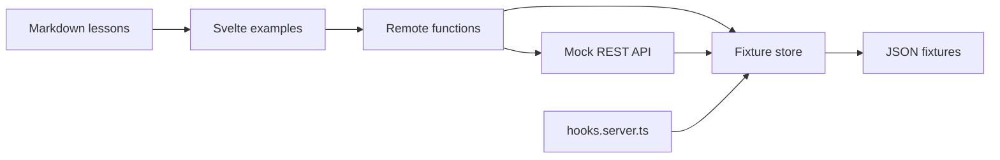

# Agentic Engineering Lab

Interactive, documentation-driven learning environment for exploring **SvelteKit remote functions**. Domain fixtures cover agentic engineering entities (projects, agents, runs, approvals) — educational scaffolding, not a real product.

## Technology stack

- SvelteKit 3 + Svelte 5 (runes, async components, remote functions)
- TypeScript 6, Vite 8, pnpm
- DocSmith (`svelte-docsmith`) for Markdown lessons and live examples
- Valibot (Standard Schema) for entity and frontmatter validation
- Vitest for shared mock-store tests
- ESLint + Prettier (Svelte support)
- `@sveltejs/adapter-node` for eventual shared deployment

## Requirements

- Node.js `>=22.17.0`
- pnpm (see `packageManager` in `package.json`)

## Install and run

```bash
pnpm install
pnpm dev
```

No environment variables, databases, Docker, or external services are required.

## Scripts

| Script | Purpose |
| --- | --- |
| `pnpm dev` | Development server |
| `pnpm build` | Production build |
| `pnpm preview` | Preview the production build |
| `pnpm start` | Run the Node adapter output (`node build`) |
| `pnpm check` | `svelte-kit sync` + `svelte-check` |
| `pnpm lint` | ESLint + Prettier check |
| `pnpm format` | Format with Prettier |
| `pnpm format:check` | Prettier check only |
| `pnpm test` | Vitest once |
| `pnpm test:watch` | Vitest watch mode |

## Repository structure

```
src/
  routes/
    docs/                 # DocSmith Markdown lessons & reference
    api/mock/             # Generic collection REST API
  lib/
    components/lab/       # Presentational lab helpers
    examples/             # Per-lesson Example.svelte (+ remote modules)
    mock/fixtures/        # Immutable JSON seed data
    schemas/              # Valibot entity schemas
    server/mock/          # Session-scoped fixture store
    frontmatter.ts        # Lesson custom-field schema
  hooks.server.ts         # Anonymous session cookie
tests/                    # Store & fixture contract tests
```

Fixtures live under `src/lib/mock/fixtures/` (not `server/`) so Markdown pages can import them for display while the store remains server-only.

## Architecture



## How to add a lesson

1. Create `src/routes/docs/lessons/<id>/+page.md` with DocSmith frontmatter (`title`, `section: Lessons`, `order`, plus custom fields).
2. Add `src/lib/examples/<id>/Example.svelte` (and `example.remote.ts` when you implement the exercise).
3. Restart is usually unnecessary — DocSmith discovers Markdown automatically for the sidebar.

Custom frontmatter fields are validated by `#lib/frontmatter.ts` via the DocSmith `schema` option.

## How to add a fixture

1. Add `src/lib/mock/fixtures/<name>.json`.
2. Define Valibot schemas in `#lib/schemas/entities.ts`.
3. Register the collection in `#lib/server/mock/collections.ts`.
4. Extend tests in `tests/`.

Keep fixtures small and cross-references valid.

## How to embed a live example

```svelte
<script>
  import { LiveExample } from 'svelte-docsmith';
  import Example from '#lib/examples/01-basic-query/Example.svelte';
  import exampleSource from '#lib/examples/01-basic-query/Example.svelte?source';
</script>

<LiveExample source={exampleSource}>
  <Example />
</LiveExample>
```

## How to expose mock data through remote functions

```ts
// example.remote.ts
import { query } from '$app/server';
import { getSessionId } from '#lib/server/mock/session.ts';
import * as store from '#lib/server/mock/store.ts';

export const getProjects = query(async () => {
  return store.list(getSessionId(), 'projects');
});
```

Remote modules use a `.remote.ts` filename segment and must **not** live under a `server/` directory.

## How to consume the mock REST API

From a remote function, prefer SvelteKit’s request-scoped `fetch` (via `getRequestEvent().fetch`) so cookies and origin stay correct:

```ts
import { query, getRequestEvent } from '$app/server';

export const getProjectsViaApi = query(async () => {
  const { fetch } = getRequestEvent();
  const response = await fetch('/api/mock/projects');
  if (!response.ok) throw new Error('Failed to load projects');
  return response.json();
});
```

See [Mock API Reference](/docs/api-reference) for endpoints, curl examples, and error shapes.

## How to reset fixture state

- UI: `ResetFixtureButton` on lesson / reference pages
- HTTP: `POST /api/mock/reset` (optional body `{ "collection": "agents" }`)

State is **ephemeral**: it resets on server restart. Sessions expire after one hour of inactivity and are capped to prevent unbounded growth.

## Known experimental API limitations

- Remote functions require `experimental.remoteFunctions` and `compilerOptions.experimental.async` in the Vite `sveltekit()` plugin.
- APIs such as `query.batch`, `query.live`, optimistic helpers, and form field bindings may change. Verify against current [SvelteKit remote function docs](https://svelte.dev/docs/kit/remote-functions) before implementing a lesson.
- If an experimental API is unavailable, leave the lesson `status: planned` (or document the limitation) rather than inventing a substitute.

## Compatibility notes

- **DocSmith + SvelteKit 3**: DocSmith `0.29.x` peer-depends on `@sveltejs/kit` `^2.16.0 || ^3.0.0` and Vite 5–8. Scaffolding already targets Kit 3 (`#lib`, no `svelte.config.js`).
- **Vite optimizeDeps**: With Vite 8, prebundling `svelte-docsmith` resolves `svelte-docsmith/site` (and related virtual modules) to published fallbacks and blanks the client UI. `vite.config.ts` excludes the package from `optimizeDeps` and sets `ssr.noExternal`. Do not remove that without re-verifying `pnpm dev`.
- A transitive peer warning may appear (`bits-ui` / `runed` advertising Kit 2). DocSmith itself supports Kit 3; do not downgrade Kit/Vite to silence the warning.
- `Handle` and related hook types import from `@sveltejs/kit/hooks` in Kit 3.

## Deployment considerations

- Adapter: `@sveltejs/adapter-node` (`pnpm build` → `pnpm start`).
- Fixture memory is process-local. Multiple Node instances do not share session maps.
- Set a stable public origin (`paths.origin` / `ORIGIN`) behind reverse proxies so CSRF checks for forms and remote functions succeed.
- Do not treat the mock store as production persistence.

## First independent lesson

1. Study [Basic Query](/docs/lessons/01-basic-query) (complete reference).
2. Open [Parameterized Query](/docs/lessons/02-parameterized-query).
3. Implement `#lib/examples/02-parameterized-query/example.remote.ts` and update `Example.svelte`.
4. Wire a `LiveExample` in the lesson Markdown when ready.
