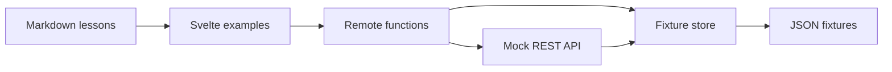

**Control Plane Lab** is an interactive, documentation-driven environment for exploring
SvelteKit **remote functions**. The thematic domain is an AI Engineering control plane —
projects, agents, runs, approvals — but the product is educational scaffolding, not a real
orchestration system.

## What you will learn

Remote functions let client components call server code with end-to-end types. This lab
scaffolds twenty lessons covering queries, forms, commands, refresh, optimistic updates,
pagination, prerendering, HTTP integration, and composition.

## What is already built

- Fixture JSON for every domain collection
- A typed in-memory store with per-visitor session isolation
- A generic mock REST API over that store
- DocSmith Markdown routes with automatic sidebar navigation
- One complete reference lesson: [Basic Query](/docs/lessons/01-basic-query)

## What you implement

Each remaining lesson ships with objectives, provided data, expected results, and a starter
`Example.svelte`. You write the remote functions and UI during independent exploration.

<Callout variant="tip" title="Guiding principle">

Build the infrastructure that makes learning possible. Do not automate the learning itself.

</Callout>

## Architecture at a glance

Continue to [Getting Started](/docs/getting-started).
